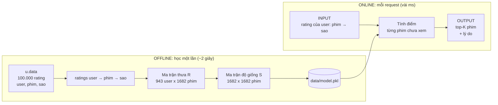
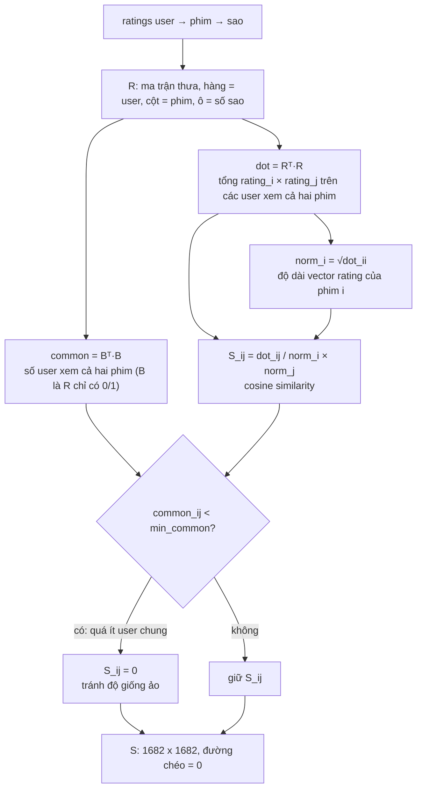
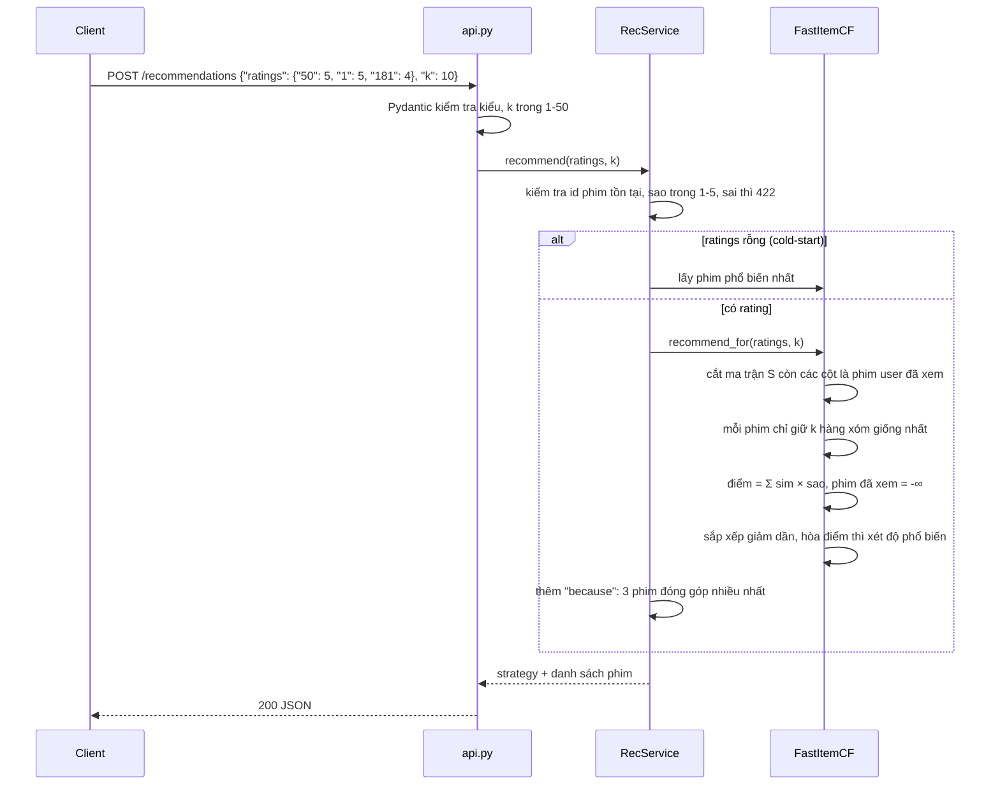
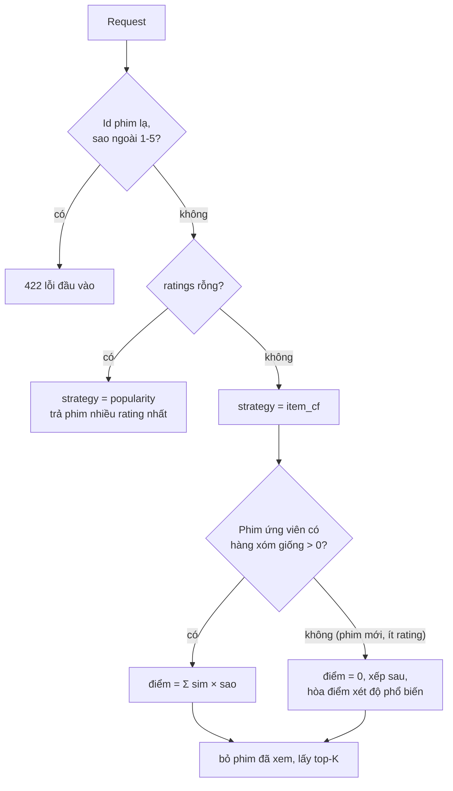
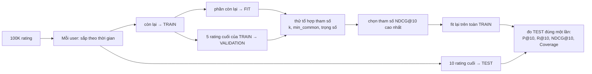

# Movie Recommender (MovieLens 100K)

Làm theo [recommender_system_y_tuong.md](recommender_system_y_tuong.md): Popularity → Content-based → Item-based CF → Matrix Factorization.

```
python main.py --user 1            # đánh giá 5 mô hình + demo gợi ý cho user 1 (~2.5 phút)
python -m unittest discover -s tests -t .  # 16 test: edge case, bản nhanh = bản chậm, API
```

Chạy như một dịch vụ:

```
python -m pip install -r requirements.txt
python -m uvicorn api:app --port 8000    # API, tài liệu tương tác tại http://localhost:8000/docs
python -m streamlit run app.py           # giao diện web (dùng chung model với API)
python tune.py                           # tune tham số trên validation (~5 phút)
```

Lần chạy đầu fit model và lưu vào `data/model.pkl` (~2 giây). Docker: `docker build -t movie-rec .` rồi
`docker run -p 8000:8000 movie-rec` (chưa build thử được trong môi trường phát triển vì Docker daemon tắt).

| Endpoint | Việc |
|---|---|
| `POST /recommendations` `{"ratings": {"50": 5, "1": 4}, "k": 10}` | Gợi ý cho user bất kỳ, kèm lý do "vì bạn đã xem…". `ratings` rỗng = phim phổ biến |
| `GET /users/{id}/recommendations?k=` | Gợi ý cho user MovieLens (1-943) |
| `GET /movies/{id}/similar?k=` | Phim giống phim này |
| `GET /movies/search?q=` | Tìm phim theo tên |
| `GET /health` | Kiểm tra sống |

Đầu vào sai (id lạ, rating ngoài 1-5, k ngoài 1-50) trả 422.

Cần Python 3 + numpy (chỉ MF dùng numpy). Dữ liệu nằm ở `data/ml-100k/`.

## Cấu trúc

| File | Nội dung |
|---|---|
| `recsys/data.py` | Đọc `u.data`, `u.item`; chia train/test theo thời gian (10 rating cuối mỗi user làm test) |
| `recsys/models.py` | `Popularity`, `ContentBased`, `ItemCF` (Python thuần, có tuỳ chọn adjusted cosine), `MatrixFactorization` (biased MF, SGD) |
| `recsys/metrics.py` | RMSE, MAE, Precision/Recall/NDCG@K, Coverage |
| `recsys/fast.py` | `FastItemCF` (ma trận thưa, fit 0.5s thay vì ~10s, kết quả khớp bản Python thuần) và `Hybrid` |
| `recsys/service.py` | Lớp dịch vụ: nạp model, validate, gợi ý + lý do, phim tương tự |
| `api.py` / `app.py` | API FastAPI / giao diện Streamlit |
| `tune.py` | Tune trên validation (tách khỏi test) |
| `Dockerfile` | Đóng gói API |
| `tests/test_toy.py` | 4 user × 5 phim, kiểm tra cosine tính tay và các edge case |
| `tests/test_service.py` | Bản nhanh khớp bản chậm; các endpoint API và mã lỗi 422 |

## Hệ thống hoạt động như thế nào

Có hai giai đoạn tách biệt: **offline** (học một lần, lưu ra file) và **online** (mỗi request chỉ tra bảng và nhân ma trận nhỏ).
Sơ đồ dùng Mermaid: xem được trên GitHub, hoặc trong VS Code với extension *Markdown Preview Mermaid Support*.

### 1. Toàn cảnh



### 2. Offline: dữ liệu → ma trận độ giống (`FastItemCF.fit`)



### 3. Online: một request đi qua những bước nào



### 4. Ví dụ có số thật

**Input:** user chấm *Star Wars* 5⭐, *Toy Story* 5⭐, *Return of the Jedi* 4⭐.

```json
{"ratings": {"50": 5, "1": 5, "181": 4}, "k": 3}
```

**Tính điểm cho phim *Raiders of the Lost Ark*** (chưa xem): tra độ giống của nó với từng phim user đã chấm trong ma trận S, nhân với số sao rồi cộng lại.

| Phim user đã xem | Sao | Độ giống với *Raiders* (S) | Đóng góp = sao × giống |
|---|---|---|---|
| Star Wars | 5 | 0.765 | 3.83 |
| Toy Story | 5 | 0.622 | 3.11 |
| Return of the Jedi | 4 | 0.733 | 2.93 |
| **Điểm tổng** | | | **≈ 9.87** |

Làm tương tự cho cả 1682 phim (bỏ phim đã xem), sắp xếp giảm dần, lấy K phim đầu.

**Output** (rút gọn):

```json
{
  "strategy": "item_cf",
  "recommendations": [
    {"id": 174, "title": "Raiders of the Lost Ark (1981)", "num_ratings": 420,
     "because": [
       {"title": "Star Wars (1977)",          "similarity": 0.765, "your_rating": 5.0},
       {"title": "Toy Story (1995)",          "similarity": 0.622, "your_rating": 5.0},
       {"title": "Return of the Jedi (1983)", "similarity": 0.733, "your_rating": 4.0}]},
    {"id": 121, "title": "Independence Day (ID4) (1996)", "...": "..."}
  ]
}
```

Vì sao xếp hạng bằng `Σ sim × sao` mà không chia trung bình: nếu chia, một phim chỉ giống đúng một phim user thích sẽ được điểm 5,
đứng đầu dù bằng chứng rất yếu. Cộng dồn thì phim giống **nhiều** phim user thích mới lên cao.

### 5. Các trường hợp rẽ nhánh



### 6. Đánh giá offline (`main.py`, `tune.py`)



TEST không bao giờ được dùng để chọn tham số, nên con số cuối không bị lạc quan giả.

## Kết quả (item liên quan = rating ≥ 4 trong test)

| Mô hình | RMSE | MAE | P@10 | R@10 | NDCG@10 | Coverage |
|---|---|---|---|---|---|---|
| Popularity | 1.078 | 0.873 | 0.058 | 0.099 | 0.085 | 5.4% |
| Content-based (thể loại) | 1.192 | 0.940 | 0.016 | 0.026 | 0.023 | 48.7% |
| **Item-based CF (cosine)** | 1.144 | 0.903 | **0.091** | **0.161** | **0.148** | 13.4% |
| Item-based CF (adjusted cosine) | 1.084 | 0.848 | 0.065 | 0.114 | 0.106 | 22.9% |
| Matrix Factorization (SGD) | **1.026** | **0.811** | 0.026 | 0.043 | 0.037 | 25.6% |

## Nhận xét

- **RMSE tốt ≠ gợi ý tốt.** MF dự đoán rating chính xác nhất nhưng top-K kém hơn cả popularity. MF chỉ học trên các ô đã có rating, nên nó xếp lên đầu những phim kinh điển ít người xem mà nó đoán sẽ được 5 sao, trong khi test đo xem user *có thực sự xem* phim đó không. Đây chính là khác biệt giữa explicit và implicit feedback.
- **Popularity baseline rất mạnh** nhưng chỉ phủ 5.4% kho phim (popularity bias). Item-CF vượt baseline (P@10 0.091 so với 0.058) và phủ rộng hơn.
- **Content-based chỉ dùng 19 thể loại** thì quá thô: rất nhiều phim trùng vector thể loại, gợi ý đa dạng nhưng gần như ngẫu nhiên. Nó hữu ích chủ yếu cho item mới (cold-start).
- **Xếp hạng của Item-CF** dùng `Σ sim·rating` (không chuẩn hoá). Nếu dùng trung bình có trọng số như lúc dự đoán rating, một phim chỉ có 1 hàng xóm được 5 sao sẽ nhận điểm 5 và lên top.
- Split theo thời gian khó hơn split ngẫu nhiên, nên RMSE cao hơn con số ~0.93 hay thấy trên mạng.
- Sparsity 93.7%: mỗi user chỉ rate khoảng 6% số phim.

## Tinh chỉnh (`tune.py`)

Grid search trên validation (5 rating cuối của mỗi user trong train), sau đó đo một lần trên test:
`k=50, min_common=3` cho NDCG@10 cao nhất. **Hybrid (thêm popularity và content) không cải thiện gì**: grid search chọn
trọng số bằng 0, và trên test chỉ hơn CF 0.001 (nằm trong nhiễu). Vì vậy dịch vụ dùng CF thuần; khi không có tín hiệu CF thì
tie-break theo độ phổ biến. Content (thể loại) chỉ có ích nếu có metadata phong phú hơn 19 thể loại.

## Hướng tiếp theo

- Dùng MF cho implicit feedback (BPR, hoặc ALS với trọng số confidence) để tối ưu trực tiếp cho top-K.
- Nguồn dữ liệu mới hơn (MovieLens 100K dừng ở 1998); lưu rating của người dùng để học dần.
- Lưu top-N hàng xóm mỗi phim thay cho ma trận dense khi kho phim lớn hơn nhiều.
- Xác thực và giới hạn tần suất gọi trước khi mở API ra internet.
